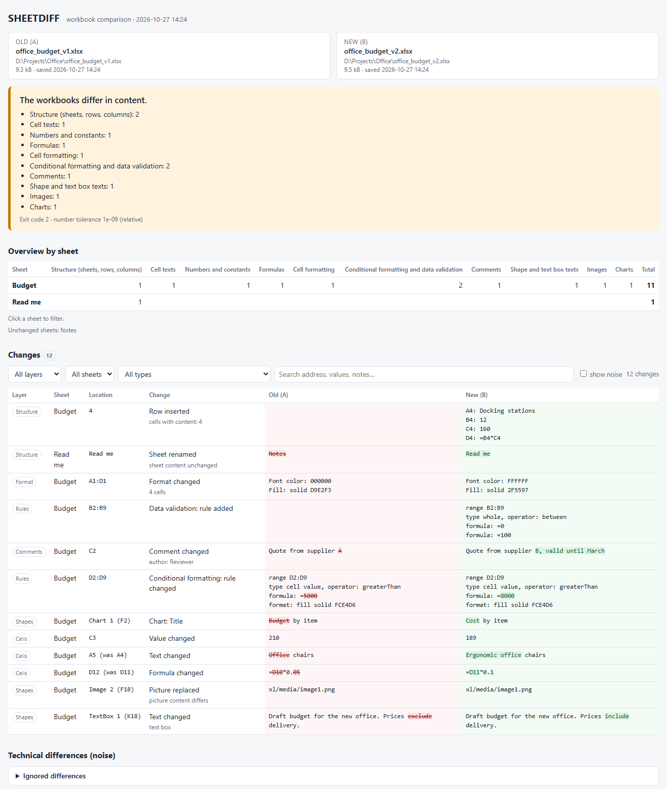
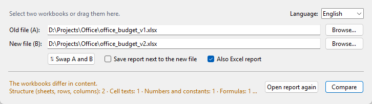

# SHEETDIFF

Compare two Excel workbooks (`.xlsx`, `.xlsm`) and see what really changed. SHEETDIFF reads the
file package directly, so it also finds changes that Excel's own Spreadsheet Compare does not show:
text in text boxes and shapes, pictures, charts, comments and the rules behind conditional
formatting.

[Česká verze](README.cs.md)



## Why

When a workbook goes through several versions (`_3`, `_4`, a colleague's restyle), you want to
know whether the numbers and formulas stayed the same and what else moved. SHEETDIFF gives one
answer at the top of the report, for example "Only cell texts changed, formulas and numbers
unchanged", and lists every change below it.

Every part of the file that differs is accounted for. If no layer can explain a difference, the
report still lists it in the Package section as "unassigned", so nothing stays hidden.

## What it compares

| Layer | Content |
|---|---|
| Structure | sheets added, removed, renamed, reordered or hidden; named ranges; external links; **inserted and deleted rows and columns** |
| Cells | values, texts, value types, formulas (shared formulas included), calculated values |
| Format | number format, font, color, fill, border, alignment, protection (grouped into ranges); merged cells; row height, column width, hidden and grouped rows and columns |
| Rules | conditional formatting (data bars and color scales included), data validation, hyperlinks |
| Shapes | text boxes and shapes (text, anchor, position, format), pictures (by content), charts (type, title, axes, series ranges) |
| Comments | text and author, classic notes and threaded comments |
| VBA | changed or unchanged (hash of the macro project) |
| Package | every part of the ZIP package that differs, with a note on which layer explained it |

Technical noise is reported separately and does not count as a change: ZIP compression, save
time, author, calculation chain, renumbered shared strings and styles, the active cell and zoom.

When rows are inserted, SHEETDIFF finds them by content and reports one "Row inserted" entry
instead of hundreds of changed cells. Formula references, named ranges, chart series and rule
ranges in the old file are shifted the way Excel shifts them, so they are not reported as changed.
References to a renamed sheet are handled the same way.

## Download

Windows: download `SHEETDIFF.exe` from [Releases](https://github.com/mrSpringpeace/SHEETDIFF/releases/latest).
It is a single file, no installation and no Python needed.

The exe is not code-signed, so Windows SmartScreen may warn on the first start
("More info", then "Run anyway"). If your antivirus blocks it, run SHEETDIFF from source instead
(see below).

## Usage

### Window

Start `SHEETDIFF.exe` (or `SHEETDIFF.bat` when running from source). Pick the old and the new
workbook with "Browse…" or **drag the files into the window**:

* one file dropped on a field goes into that field,
* two files dropped together are ordered by save date, the older one becomes A.

Dropping two files on the exe itself (or on a shortcut to it) compares them straight away.
The report opens in the browser. Tick "Also Excel report" to get the list of changes as an `.xlsx`
for filtering.



The language (English or Czech) is switched in the top right corner and applies to the window and
the reports. The choice is remembered in `%APPDATA%\SHEETDIFF\settings.json`.

### Command line

```bat
python -m sheetdiff old.xlsx new.xlsx -o report.html --excel --lang en --open
SHEETDIFF.exe --cli old.xlsx new.xlsx -o report.html --lang en
```

| Option | Meaning |
|---|---|
| `-o PATH` | HTML report path (default: `%TEMP%\SHEETDIFF`) |
| `--excel` | also write an Excel report next to the HTML |
| `--lang cs\|en` | report language |
| `--skip LAYER` | skip a layer: `struktura`, `bunky`, `format`, `pravidla`, `tvary`, `komentare`, `balicek` |
| `-t TOL` | relative tolerance for numbers (default `1e-9`) |
| `--open` | open the report in the browser |

Exit code: `0` no differences, `1` technical noise only, `2` content differences, `3` error.
The exe is a window application, so use `start /wait SHEETDIFF.exe --cli …` when a script needs
the exit code.

## How it works

An `.xlsx` file is a ZIP package of XML parts. SHEETDIFF opens both packages, reads the parts with
`lxml` and compares them layer by layer. Excel is not needed and the files are only read, never
written. Two 4 MB workbooks with pictures compare in about one second.

## Running from source

Python 3.11 or newer with `lxml` and `openpyxl`:

```bat
python -m pip install lxml openpyxl
python -m sheetdiff old.xlsx new.xlsx --open
```

`SHEETDIFF.bat` starts the window with the Python found on the PATH.

## Example files

`examples/office_budget_v1.xlsx` and `_v2.xlsx` are an invented office budget with one change of
each kind (inserted row, edited text, number, formula, format, comment, conditional formatting,
data validation, chart title, picture, text box, renamed sheet). `tools/demo.py` creates them.

## Building the exe

`build_exe.bat` builds `dist\SHEETDIFF.exe` with [Nuitka](https://nuitka.net) (onefile, the Zig
C compiler is downloaded automatically). `tools/make_screenshot.py` renders the screenshots above
from the example files.

## Tests

```bat
python tests\acceptance.py
```

The tests build their own workbooks (the example budget and small generated files) and check each
kind of change, the noise handling, the Excel report and that the English report contains no
Czech labels.

## Translations

Texts in the code are Czech and wrapped in `_()`; the English dictionary is in
`sheetdiff/i18n.py`. Source comments are in Czech.

## Limitations

* Form controls, sparklines, slicers, tables, pivot tables and theme colors are not interpreted
  yet. Their changes appear in the Package section as unassigned.
* Inserted rows and columns are found by content. If rows and columns with content are inserted
  at the same time, cells are paired by address.
* VBA is compared as a whole (changed or not), not module by module.
* Password-protected workbooks and the old `.xls` format are not supported.

## License

MIT, see [LICENSE](LICENSE).
